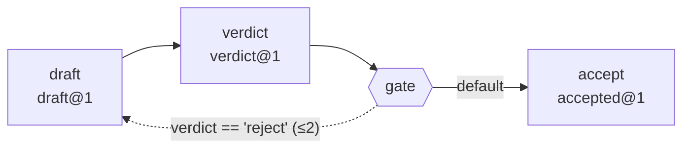

# agentic-sop-to-work

[](https://claude.com/claude-code) [](LICENSE) [](plugins/agentic-sop-kit/.claude-plugin/plugin.json) [](plugins)

> Turn a process you do by hand into steps a program runs — and never let the AI make up facts, loop forever, or have the final say.
> 把你手動做的流程，變成程式一步步執行的流程——而且不讓 AI 編造事實、無限打轉，或替你做最後決定。

```
/plugin marketplace add s0912758806p/agentic-sop-to-work
/plugin install agentic-sop-kit@agentic-sop-to-work
/reload-plugins
```

**🌐 [English](#english) ・ [繁體中文](#繁體中文)**


*Follow the dot: 🟢 passed · 🔴 blocked · 🟠 retried or sent back, always with a limit · 🟣 handed to review.<br>跟著圓點走：🟢 通過 · 🔴 擋下 · 🟠 重試或退回（一定有上限） · 🟣 交給審查。*

---

## English

**How it works** — the five things the animation shows:

1. **Check the plan first.** `run.py --plan` reads the whole flow and refuses one with a dead end or an endless loop *before anything runs*.
2. **Code runs every step.** One step = one tool. If a tool fails or writes nothing, the run stops. To also verify *what* it wrote, attach a gate (`cmd_gate` · `schema_gate` · `trace_gate` · `recompute_gate` · `residual_gate`) — plain code, no AI grading itself.
3. **Retries have limits.** `/sop-flow` auto-fixes and re-runs a failed step up to 3 times (configurable), and stops early if it is going in circles. A review step can send work back, but only as many times as the flow declares.
4. **The result is a DRAFT.** Missing facts are marked `【待補】`, never invented. Before a human signs off, `second-opinion-honesty` and `alcoa-guard` can check the draft.
5. **Every code change is re-tested.** In a project that uses the kit, a Stop hook runs the regression tests when Claude finishes, and blocks if something broke.

**What's in the box** — four plugins, pure Python standard library, every report is a DRAFT:

| Plugin | In plain words |
|---|---|
| `agentic-sop-kit` — **4 Skills** | `six-rung-ladder`: should we build this at all? · `agentic-sop`: turn an SOP into a flow · `agentic-workflow-audit`: catch a "do-everything" agent · `/agentic-sop-kit:sop-flow`: run the flow, get a DRAFT |
| `second-opinion-honesty` | Checks a DRAFT's claims against its own evidence: made-up numbers, invented IDs, overreach. Findings are hard on a kit run, advisory on a plain document. |
| `alcoa-guard` | ALCOA+ data-integrity checks — who, when, complete, accurate, consistent. What needs human judgment becomes a `【待補】` checklist. |
| `plugin-forge` | Lints and scaffolds Claude Code plugins: manifests, skills, hooks, stdlib-only code, vendored-core drift, and current platform features (`agents/`, `userConfig`, exec-form hooks). |

**Install** — the three lines at the top. Needs **Python 3.8+** as `python3`. Check: `/help` lists `/agentic-sop-kit:sop-flow`. Settings when you enable the plugin: `max_fix_retries` · `stall_window` · `keep_runs`.

**Compatibility** — what CI actually runs on every PR, for all four plugins:

| | Python 3.8 | Python 3.x (latest) |
|---|---|---|
| Linux (ubuntu) | ✅ tested (22.04) | ✅ tested |
| macOS | — | ✅ tested |
| Windows | — | ⚠️ runs in CI, non-blocking |

**Go deeper** — [`kit/README.md`](plugins/agentic-sop-kit/kit/README.md): the engine, gates, graph features, settings · [`kit/SOP.md`](plugins/agentic-sop-kit/kit/SOP.md): the method · [`CONTRIBUTING.md`](CONTRIBUTING.md): tests, versioning, releases · [`MIGRATION.md`](MIGRATION.md): what v2.0 removes · [`CHANGELOG.md`](CHANGELOG.md).

**Update** — `/plugin marketplace update agentic-sop-to-work`, then `/reload-plugins`. Each release is a git tag (`vX.Y.Z` for the kit, `<plugin>-vX.Y.Z` for the others) with a GitHub release.

---

## 繁體中文

**怎麼運作** — 動畫裡的五件事：

1. **先檢查流程。** `run.py --plan` 讀完整張流程圖；有死路或無限迴圈，*還沒開跑*就拒絕。
2. **每一步都由程式執行。** 一步＝一個工具。工具失敗或沒有產出，流程就停。要再驗證產出*內容*，就在那一步掛上閘門（`cmd_gate` · `schema_gate` · `trace_gate` · `recompute_gate` · `residual_gate`）——全是程式，不讓 AI 自己打分數。
3. **重試有上限。** `/sop-flow` 遇到失敗會自動修、重跑，最多 3 次（可調），原地打轉就提早停。審查步驟可以退件重做，但次數不能超過流程宣告的上限。
4. **產出只是草稿。** 缺的事實標 `【待補】`，絕不編造。交給人核准之前，可以先用 `second-opinion-honesty` 和 `alcoa-guard` 檢查。
5. **每次改程式都重新測試。** 在導入 kit 的專案裡，Claude 收工時 Stop hook 會自動跑回歸測試，壞了就擋下。

**你會得到** — 四個 plugin，純 Python 標準庫，所有報告都是草稿：

| Plugin | 白話說明 |
|---|---|
| `agentic-sop-kit` — **4 支 Skills** | `six-rung-ladder`：這東西到底該不該做？· `agentic-sop`：把 SOP 變成流程 · `agentic-workflow-audit`：抓出「什麼都做」的 agent · `/agentic-sop-kit:sop-flow`：跑流程、拿到草稿 |
| `second-opinion-honesty` | 拿草稿的說法去對它自己的證據：編造的數字、發明的編號、說過頭。審 kit 的 run 是硬性發現，審一般文件只給建議。 |
| `alcoa-guard` | ALCOA+ 資料完整性檢查——誰做的、何時、完整、正確、一致。需要人判斷的部分變成 `【待補】` 清單。 |
| `plugin-forge` | 檢查並產生 Claude Code plugin：manifest、skill、hook、只用標準庫、共用核心有沒有漂移，以及新版平台功能（`agents/`、`userConfig`、exec-form hook）。 |

**安裝** — 最上面那三行。需要 **Python 3.8+**，且能用 `python3` 呼叫。確認：`/help` 看得到 `/agentic-sop-kit:sop-flow`。啟用 plugin 時可設定：`max_fix_retries` · `stall_window` · `keep_runs`。

**相容性** — CI 每個 PR 對四個 plugin 實際跑的組合：

| | Python 3.8 | Python 3.x（最新） |
|---|---|---|
| Linux（ubuntu） | ✅ 已測（22.04） | ✅ 已測 |
| macOS | — | ✅ 已測 |
| Windows | — | ⚠️ CI 有跑，不擋合併 |

**深入了解** — [`kit/README.md`](plugins/agentic-sop-kit/kit/README.md)：引擎、閘門、圖狀流程、設定 · [`kit/SOP.md`](plugins/agentic-sop-kit/kit/SOP.md)：方法論 · [`CONTRIBUTING.md`](CONTRIBUTING.md)：測試、版本、發版 · [`MIGRATION.md`](MIGRATION.md)：v2.0 會移除什麼 · [`CHANGELOG.md`](CHANGELOG.md)。

**更新** — `/plugin marketplace update agentic-sop-to-work`，再 `/reload-plugins`。每個版本都有 git tag（kit 是 `vX.Y.Z`，其他是 `<plugin>-vX.Y.Z`）和 GitHub release。

---

<details>
<summary>A real flow, drawn from code · 一個真實流程（由程式畫出）</summary>

<!-- BEGIN GENERATED: topology -->

<!-- END GENERATED: topology -->

*The shipped `graph.json` example: draft → verdict → a reject sends it back (at most twice) → accept. Generated by `run.py --graph` and byte-compared by `kit/tests/test_graph_docs.py`, so the picture cannot drift from the flow.<br>出貨的 `graph.json` 範例：起草 → 判定 → 退件就回頭（最多兩次）→ 接受。由 `run.py --graph` 產生、測試逐位元組比對，圖不可能和流程不一致。*

</details>

**License** — MIT ([`LICENSE`](LICENSE) · [`NOTICE`](NOTICE)); keep the notice in copies, including single files. · 授權 MIT，副本（含單一檔案）需保留聲明。
